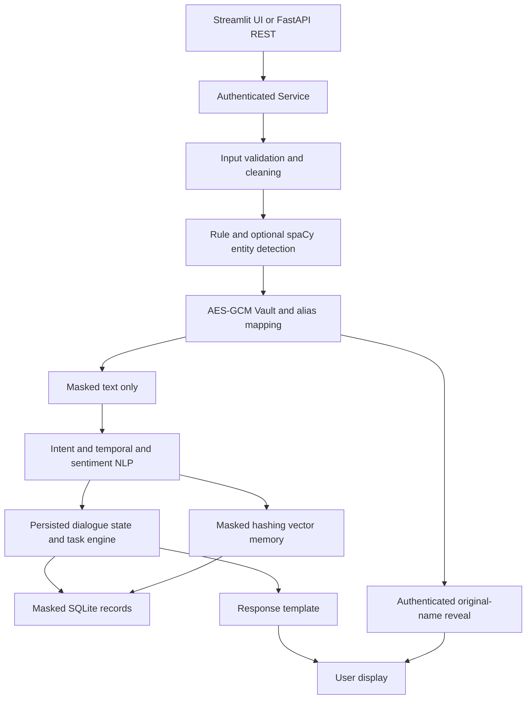

# Architecture

- `contextcare/core.py`: SQLite schema installation, AES-256-GCM vault, scrypt authentication, permission checks and scrubbed logging filter.
- `contextcare/nlp.py`: heuristic and optional spaCy spans, time normalization, word/token heuristics, lexicon sentiment, intent classifier wrapper.
- `contextcare/engine.py`: pseudonymization, masked hashing embeddings, thresholded cosine retrieval, persisted task state and replies.
- `contextcare/api.py`: authenticated HTTP endpoint adapters.
- `app.py`: authenticated Streamlit 10-screen local interface.
- `scripts/train.py`: synthetic training corpus and grouped holdout evaluation.
- `scripts/evaluate.py`: small independent sanity evaluations.

## Persistence order
User input is validated and held only in process memory during the request. The entity detector produces in-memory source spans. The privacy layer stores cryptographic ciphertext and HMAC blind indexes, creates stable aliases, and reconstructs masked text in one pass. **Only then** are masked conversation messages processed for downstream state, embeddings, tasks, and analytics. The explicit identity-continuity action decrypts only for the authenticated display response and records a masked assistant message.

## Coreference level
The implementation supports context-bound mentions such as **that meeting**, **the meeting** and **that task** by using the active task ID or recent task. It does **not** include a trained neural coreference model, a general-purpose salience scorer or broad pronoun disambiguation. Ambiguous cases require further engineering.

## Local running
Streamlit calls `Assistant` in-process. FastAPI can run separately and shares the same SQLite database. Concurrent multi-process write-heavy use is not hardened.
