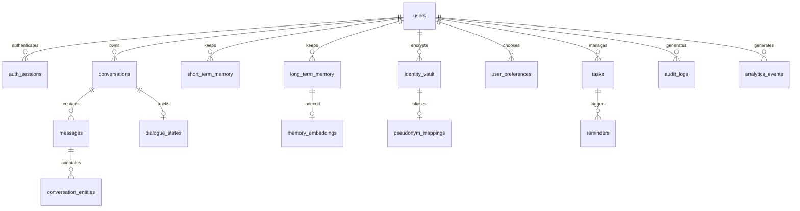

# Database design

Migration: `migrations/001_init.sql`. SQLite FK enforcement is ON. Primary keys are opaque UUIDs; dependent tables use cascaded deletes where appropriate.

The names in `users.username` are user-chosen account handles and are **not automatically pseudonymised**. User messages, memories, and titles are masked, subject to detection limitations. Key material is **not in the SQLite database**. Text in `identity_vault` is AES-GCM ciphertext, with a random per-record 96-bit nonce, AAD `user_id:entity_type`, and HMAC blind index.

`memory_embeddings.vector` stores exactly 256 `float32` components computed from masked input using scikit-learn `HashingVectorizer`. Indexes exist on message conversation, task due dates, account-alias scope and memory owners.
